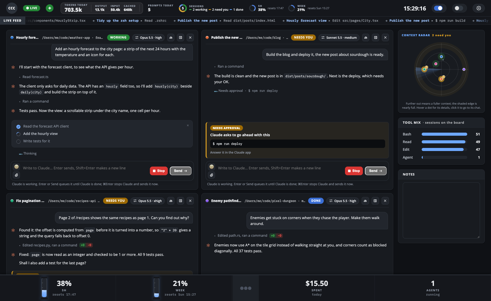
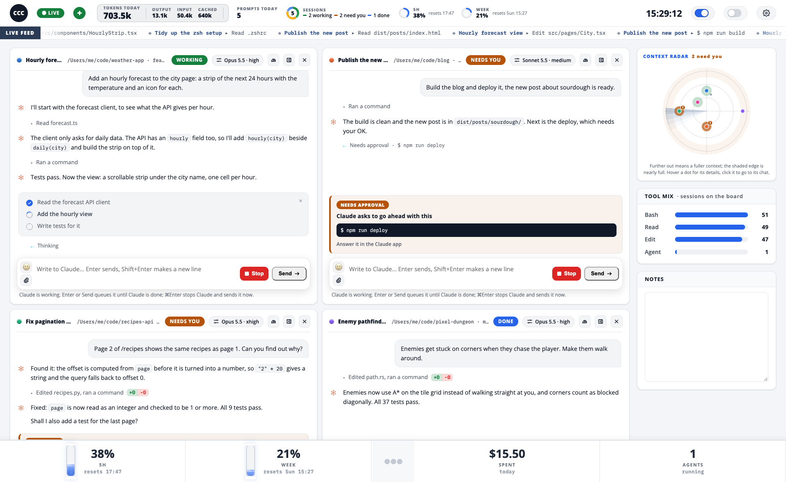
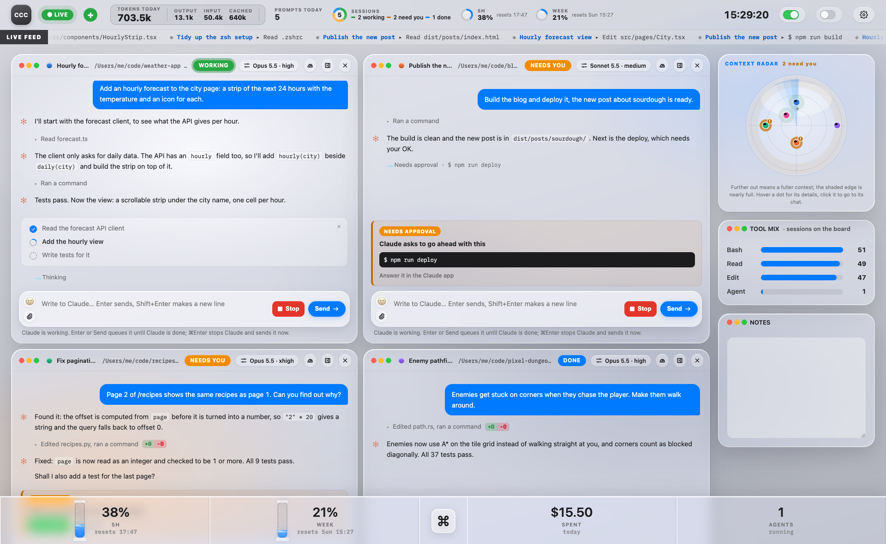
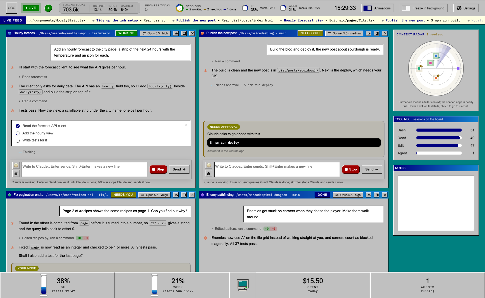
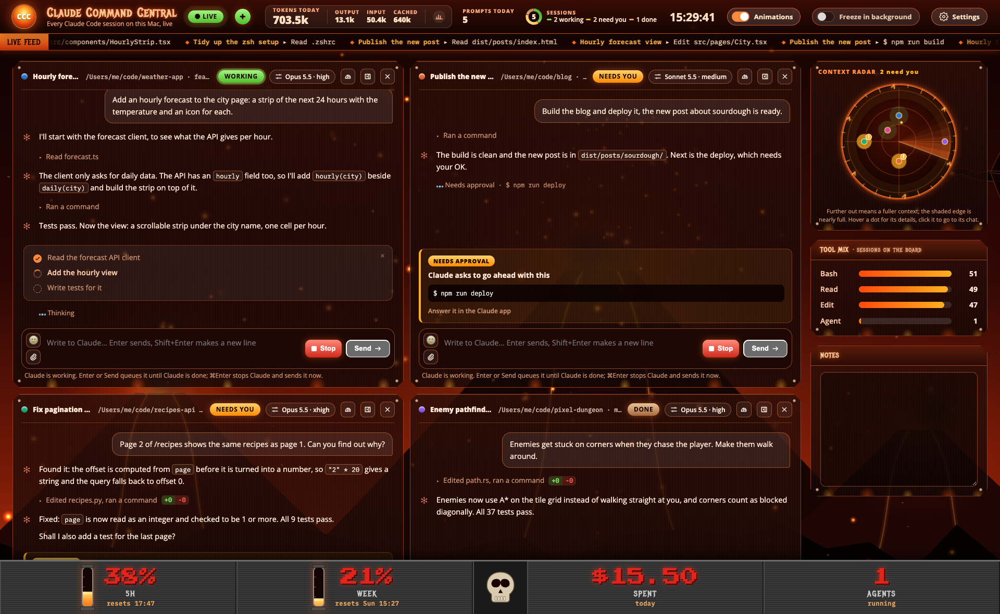
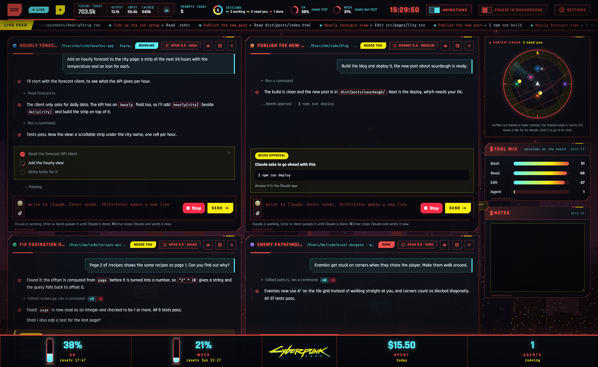
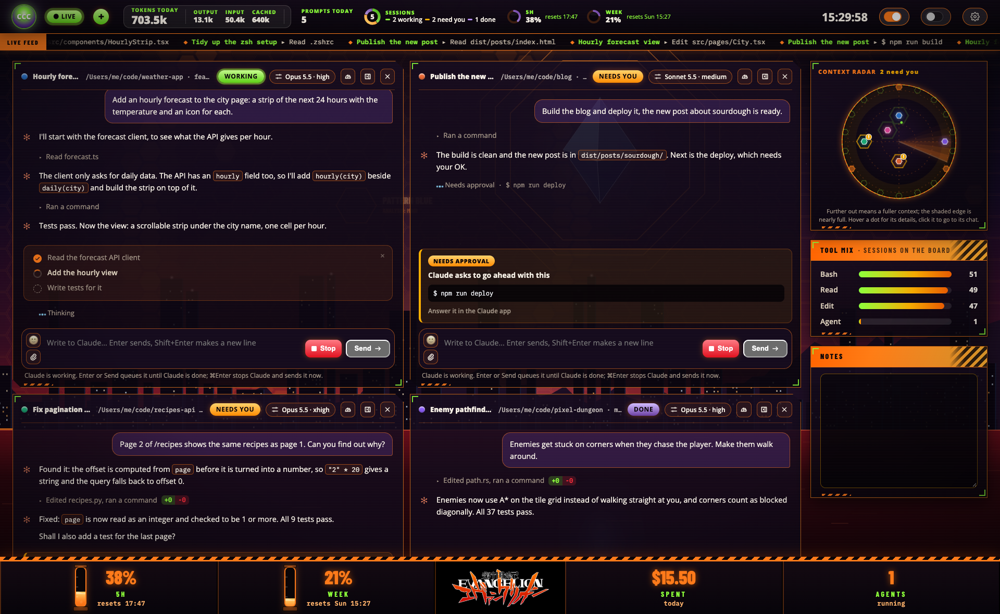

# CCC: Claude Command Central

A live board of every Claude Code session on your Mac, from the Claude app, VS Code and the terminal. See what each one is doing, which ones need you, how full their context is, their agents, tokens and cost. Chat with them, answer their questions and approvals, and run terminals, all from one page.



## What you need

- macOS (might make this OS-independant in the future idk)
- Claude Code with mods (built on 2.1.312; mods are early access and may change)
- Python 3
- Google Chrome or Microsoft Edge, for the board's own window (optional)
- Node, only to run the board's tests

## Install

1. Clone it into your mods folder:

   ```bash
   git clone https://github.com/Frequill/claude-command-central.git ~/.claude/mods/ccc
   ```

2. Add this to `~/.claude/settings.json`, merged with what is already there. Replace `YOU` with your user name.

   ```json
   {
     "env": {
       "CLAUDE_CODE_PLUGIN_DIRS": "/Users/YOU/.claude/mods/ccc",
       "CLAUDE_CODE_PLUGIN_DIR_WATCH": "1"
     },
     "hooks": {
       "Notification": [
         { "matcher": "permission_prompt", "hooks": [{ "type": "command", "command": "/usr/bin/python3 /Users/YOU/.claude/mods/ccc/board/prompt_seen.py", "timeout": 10 }] }
       ],
       "PermissionRequest": [
         { "matcher": "AskUserQuestion", "hooks": [{ "type": "command", "command": "/usr/bin/python3 /Users/YOU/.claude/mods/ccc/board/answer_from_ccc.py", "timeout": 3600 }] },
         { "matcher": "*", "hooks": [{ "type": "command", "command": "/usr/bin/python3 /Users/YOU/.claude/mods/ccc/board/approve_from_ccc.py", "timeout": 3600 }] }
       ]
     }
   }
   ```

3. Add the `ccc` command to `~/.zshrc`:

   ```bash
   ccc() {
     "$HOME/.claude/mods/ccc/board/ccc" "$@"
     local code=$?
     if [ $code -eq 100 ]; then exit; fi
     return $code
   }
   ```

4. Open a new terminal and run `ccc`. `ccc stop` stops the board's server.

Sessions already running pick CCC up when their current turn ends; new ones have it right away.

## Sessions in the background

The **+** in the header starts a session **in the background** by default: its card comes onto the board at once, and the first message you write there, with any images, videos or files, starts it. CCC runs `claude` itself, in the folder and mode you pick, and nothing opens. It works like any other session on the board, and you chat with it, answer its questions and approve its steps there. Its `>_` button shows the terminal it runs in; the × on that terminal hides it again, and Claude keeps working. The ⓘ next to the choice says what it means. Its settings (the model chip on its card) switch its **mode** too: manual, accept edits, plan or auto. CCC presses Shift+Tab in its terminal until Claude's own mode line shows the one you picked, and the card always shows the mode that line says.

A card's × offers two things. **Close**: a session in the background stops (one Claude runs in the Claude app or a terminal goes on there), and the conversation stays in Claude's history, to pick up again from + → From an existing conversation or `claude --resume`. **Close and delete**: the conversation is gone from Claude (its history, `claude --resume` and + → From an existing conversation), and everything kept for it moves to your Trash, in one folder, so it can be put back. A session in the background is stopped first; one Claude still runs in the Claude app or a terminal has to be closed there first. The Claude app keeps its own list of sessions, which only the app can change: delete it there too.

In a folder Claude was never told to trust, Claude asks first. Its terminal then comes onto the board, so you can answer.

The terminals on the board, background sessions included, run in CCC's keeper (`board/keeper.py`), a small program of its own that CCC starts when it needs it. So they keep running when you close the Claude app, your terminal windows or the board's server. `ccc stop` stops only the server; the next `ccc` finds them again. `ccc stop --all` also stops the keeper, which ends them (it asks first). A restart of your Mac ends them too.

In Activity Monitor the board's server shows as **Claude Command Central** and the keeper as **Claude Command Central keeper**, with the shells and background sessions under them as `zsh` and `claude`. To do this, CCC starts Python through files named after them, in `~/.claude/ccc/programs` (on a Mac, copies of Python's small starter program; a link would still show as Python).

**Settings → Background sessions** lists what runs in the keeper, with Show and End for each and End everything for all. A background session that stopped without you ending it (your Mac restarted) is listed there under Stopped, to resume in the background again; Claude starts only with a message, so it goes in with one. Nothing resumes by itself. If the keeper goes away while background sessions run in it, without you ending it (it crashed, or was force-quit in Activity Monitor), they stop with it. A message in the middle of the board says so, with **Resume all** and **Close**; closed, it leaves each one's card greyed out with a **Restart** button until it runs again. CCC can only notice this while its server runs. After an update of CCC, a keeper with things running in it keeps its old code until you restart it there.

Every working agent and background command on the agent map has a **Stop**: click it, then click again within a few seconds, and that one ends while its session's turn goes on.

## Opening code in your editor

With **Settings → Terminal & editor → Open Claude's files and code in** set to an editor (IntelliJ IDEA or VS Code), the files, classes, methods and constants Claude names in its replies (`AbstractDuoNode.java`, `releasePushCall`, `pushCall.getPushSuccess()`) open in it where they are made: click one. A name made in a few places (an interface and its implementation) asks which. CCC looks for them in the session's folder, or in each repository in it for a folder of projects, with `git grep`; a chip that points nowhere, or at more than 8 places, stays plain text, and so does a plain word such as `run` unless it is called, `run()`. A getter that Lombok makes opens at its field. A file a step changed opens from that step too.

## Designs

When Claude makes a design in a session (Claude Design), its card gets a **Design** button, with a dot while there are screens you have not looked at. It shows the design's screens in place of the chat, laid out as the canvas has them and scaled to the card, each a live page that follows Claude's changes; click one to see it large. **Open the canvas** opens the real canvas in Claude, for panning, comments and sharing: claude.ai does not let its canvas be shown inside another page, so the card shows the screens' own files, run walled off from the board.

## Artifacts

When Claude publishes an artifact in a session (the Artifact tool), its card gets an **Artifact** button, with a dot while there is one you have not looked at. It shows the artifact beside the chat, as the Claude app shows it at its side: the card widens to the board's full width, the cards beside it move down, and the artifact is a live page you use right there. With several, a list picks one; one Claude publishes again loads again. **Open on claude.ai** opens the real one. The board shows the page's own file from this Mac, walled off from the board, so what needs claude.ai itself (data kept for its viewers, files people add, asking Claude) works there. Closed, the card goes back to its size and the cards it moved come back up. In a narrow window the artifact goes under the chat.

**+ → An artifact** lists every artifact Claude published in a conversation on this Mac, the one changed last first, to search by title, session or folder. **Open in CCC** puts one on the board as a card of its own, in the space whose + you clicked, to move and size like any card; it stays across reloads until its × takes it off. One whose page is no longer on this Mac has its claude.ai link instead.

## Themes

Twelve of them, from Clean to Cyberpunk 2077. Pick one in Settings.

| | | |
|---|---|---|
|  |  |  |
|  |  |  |

## Safety

The board only listens on `127.0.0.1` and refuses requests from other pages. It can run shells and approve Claude's tool calls, so never expose it beyond your own machine. The keeper listens on `127.0.0.1` too, and answers only requests that carry the key in `~/.claude/ccc/keeper.json`, a file only your user can read.

## Tests

```bash
cd ~/.claude/mods/ccc/board && python3 -m unittest test_serve test_keeper && node --test test_board.mjs && bash test_ccc.sh
```

```bash
claude plugin test ~/.claude/mods/ccc
```

## Credits

Version 1.0 was created by [Love Klockars](https://github.com/lokl4297). Fan themes are a hobby: their names and logos belong to their owners, and this project is not for sale.
