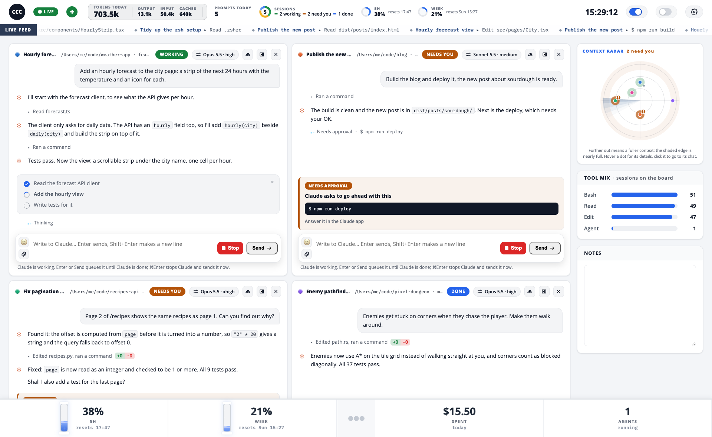
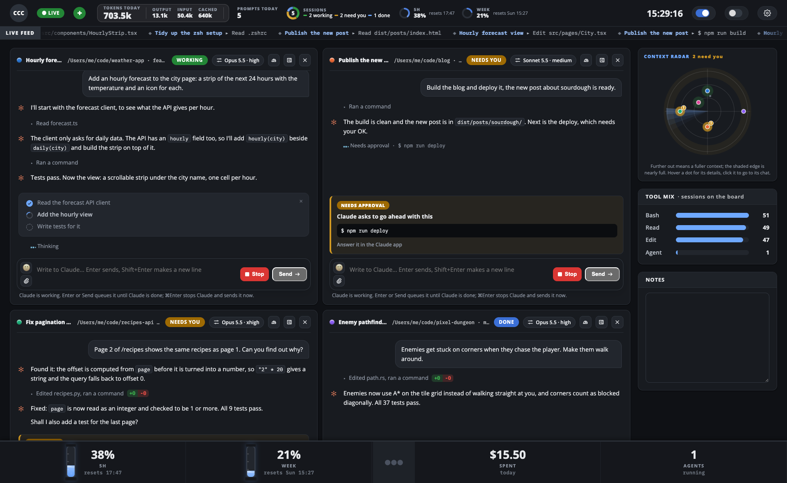
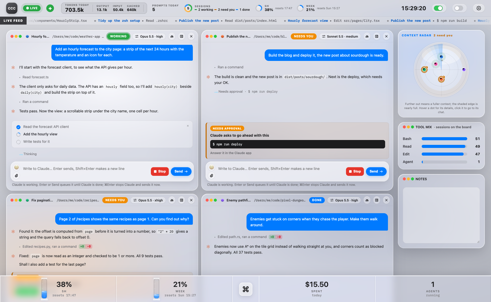
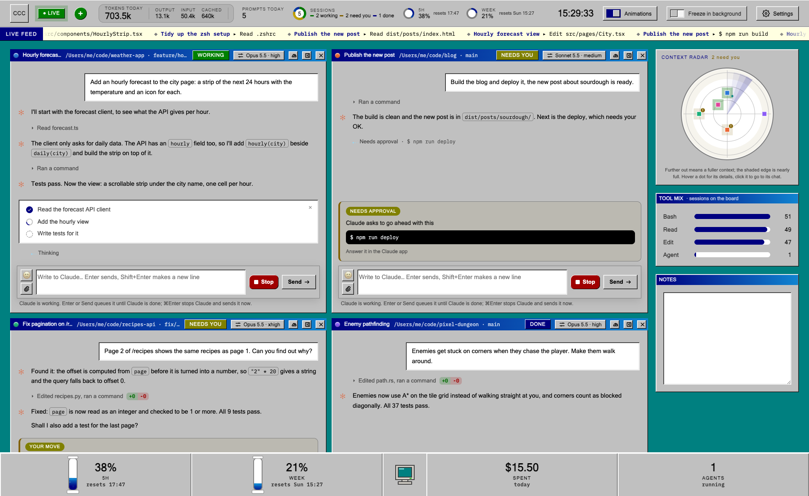
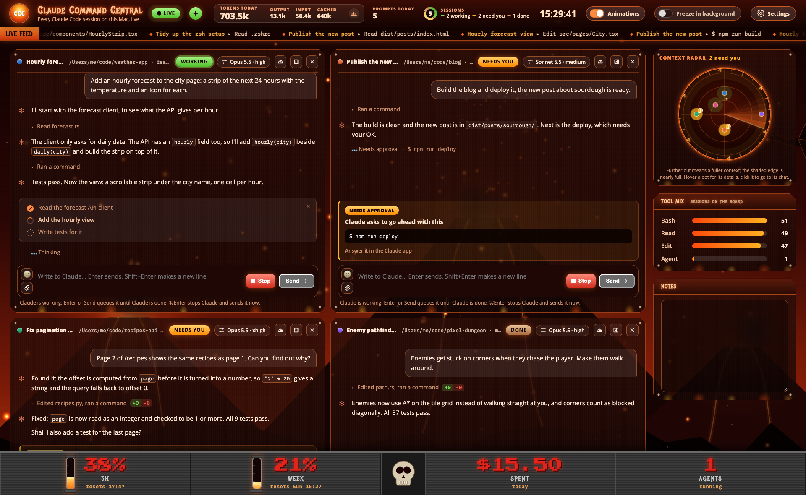
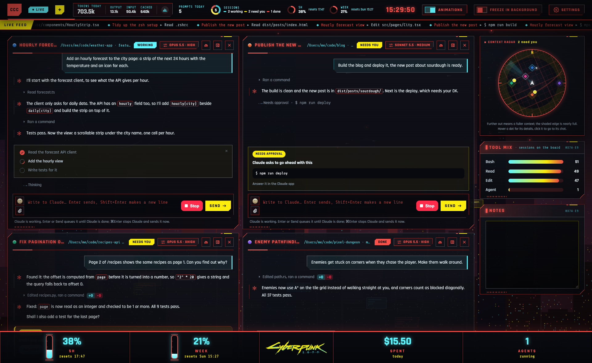
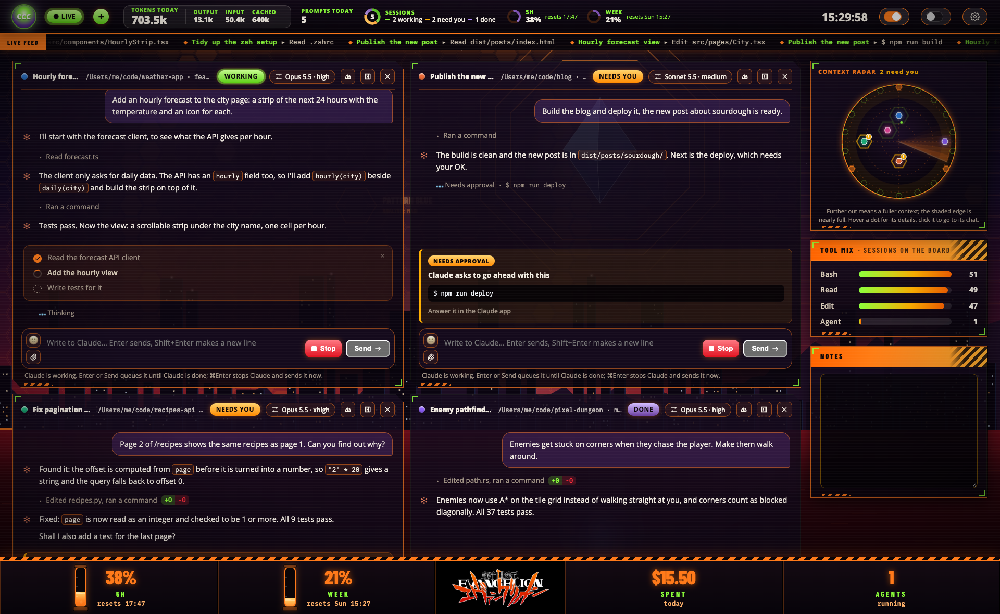

# CCC: Claude Command Central

A live board of every Claude Code session on your Mac, from the Claude app, VS Code and the terminal. See what each one is doing, which ones need you, how full their context is, their agents, tokens and cost. Chat with them, answer their questions and approvals, and run terminals, all from one page.



## What you need

- macOS
- Claude Code with mods (built on 2.1.312; mods are early access and may change)
- Python 3
- Google Chrome or Microsoft Edge, for the board's own window (optional)
- Node, only to run the board's tests

## Install

1. Clone it into your mods folder:

   ```bash
   git clone https://github.com/Frequill/claude-command-central.git ~/.claude/mods/ccc
   ```

2. Add this to `~/.claude/settings.json`, merged with what is already there. Replace `YOU` with your user name.

   ```json
   {
     "env": {
       "CLAUDE_CODE_PLUGIN_DIRS": "/Users/YOU/.claude/mods/ccc",
       "CLAUDE_CODE_PLUGIN_DIR_WATCH": "1"
     },
     "hooks": {
       "Notification": [
         { "matcher": "permission_prompt", "hooks": [{ "type": "command", "command": "/usr/bin/python3 /Users/YOU/.claude/mods/ccc/board/prompt_seen.py", "timeout": 10 }] }
       ],
       "PermissionRequest": [
         { "matcher": "AskUserQuestion", "hooks": [{ "type": "command", "command": "/usr/bin/python3 /Users/YOU/.claude/mods/ccc/board/answer_from_ccc.py", "timeout": 3600 }] },
         { "matcher": "*", "hooks": [{ "type": "command", "command": "/usr/bin/python3 /Users/YOU/.claude/mods/ccc/board/approve_from_ccc.py", "timeout": 3600 }] }
       ]
     }
   }
   ```

3. Add the `ccc` command to `~/.zshrc`:

   ```bash
   ccc() {
     "$HOME/.claude/mods/ccc/board/ccc" "$@"
     local code=$?
     if [ $code -eq 100 ]; then exit; fi
     return $code
   }
   ```

4. Open a new terminal and run `ccc`. `ccc stop` stops the board's server.

Sessions already running pick CCC up when their current turn ends; new ones have it right away.

## Themes

Twelve of them, from Clean to Cyberpunk 2077. Pick one in Settings.

| | | |
|---|---|---|
|  |  |  |
|  |  |  |

## Safety

The board only listens on `127.0.0.1` and refuses requests from other pages. It can run shells and approve Claude's tool calls, so never expose it beyond your own machine.

## Tests

```bash
cd ~/.claude/mods/ccc/board && python3 -m unittest test_serve && node --test test_board.mjs && bash test_ccc.sh
```

```bash
claude plugin test ~/.claude/mods/ccc
```

## Credits

Version 1.0 was built by Love. Fan themes are a hobby: their names and logos belong to their owners, and this project is not for sale.
